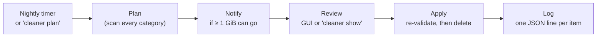

# cleaner

**Approve-first disk cleanup for Linux desktops.** cleaner finds the junk you could regenerate in a minute (build artifacts, tool caches, stale worktrees, Docker leftovers, old Nix generations) and shows you a plan. It deletes exactly what you approve and nothing else.

[](LICENSE)


```text
$ cleaner plan
Plan 20261111T072600Z
  artifacts        21 selected     8.1 GiB
  worktrees        12 selected     1.1 GiB
  caches            2 selected    23.7 GiB  (+1 report only)
  app_caches       10 selected    10.3 GiB
  user_rules        0 selected         0 B
  trash             0 selected         0 B
  idle_folders      0 selected         0 B  (+2 report only)
  docker            0 selected         0 B
  nix               1 selected         0 B
Total selected: 43.3 GiB in 46 items
Skipped: 25 (see `cleaner show`)

$ cleaner show       # every item, grouped by category, with the reason it's there
$ cleaner apply      # re-checks each item, then deletes only what's selected
```

---

## Why

A developer machine fills up quietly. `target/` dirs in projects you haven't opened in months. `node_modules/` in twenty worktrees. Go, npm, pip and cargo caches. Old Nix generations pinning tens of gigabytes. Docker build cache. Every so often you notice the disk is at 95% and spend an evening running `du` and deleting by hand.

Existing tools each cover one slice: kondo does build artifacts, nh does Nix, autotrash does the Trash, BleachBit does app and system caches. cleaner covers the whole list in **one binary**, runs on a schedule, and still **never deletes without your say-so**.

## How it works



1. **Plan.** A scan of every enabled category writes a plan file. Each entry has its size, the reason it's there, and a fingerprint, and is either pre-selected or not. Anything skipped is listed with the reason.
2. **Notify.** If the pre-selected total crosses a threshold (1 GiB by default), you get a desktop notification. Clicking it opens the plan.
3. **Review.** Tick and untick in the GUI, or read it with `cleaner show`.
4. **Apply.** Every approved item is **re-validated** first: it must still exist, still not be a symlink and still match its fingerprint, and its owning app must not be running. Anything that drifted is skipped, never silently re-planned.
5. **Log.** Every deletion and skip is appended to a JSON-lines log, along with the bytes actually freed.

## What it finds

| Category | What | Pre-selected by default |
|---|---|---|
| **Project artifacts** | `target/`, `node_modules/`, `.venv/`, `.terraform/`, `build/`, `zig-out/`, `_build/`, `dist-newstyle/`, `.godot/` and more, across Rust, Node, Python, Terraform, Gradle, Maven, CMake, .NET, Zig, Composer, Elixir, Haskell, Godot and Jupyter. An artifact counts only next to its project marker (`Cargo.toml`, `package.json`, …). Add your own as `target@marker`. | When the project is untouched for 30 days, or is a finished worktree |
| **Tagged caches** | Any dir carrying a valid [`CACHEDIR.TAG`](https://bford.info/cachedir/), except venvs and the uv cache | Never |
| **Finished worktrees** | Linked git worktrees that are clean and whose branch is merged (or that git no longer knows about), removed with `git worktree remove` | After 3 idle days |
| **Tool caches** | cargo registry and git checkouts, go-build, Go module cache, npm, bun, pip, poetry, pnpm, Playwright, Cypress, Puppeteer, thumbnails, Terragrunt/OpenTofu providers, and your own rules. `uv cache prune` is run through `uv`, because its cache is hardlinked into live venvs. | Per rule (age-based) |
| **Browser & Electron caches** | `Cache`, `Code Cache`, `GPUCache` and Service Worker caches for Chrome, Chromium, Firefox, Slack, Teams, Discord, Claude and Cursor (add your own), plus Chromium's on-device AI model | Yes, but **skipped at apply time if the app is running** |
| **Docker** | Stopped containers, dangling and unused images, unused volumes, buildx builders, old build cache, planned and deleted **by ID** | Stopped containers > 7 d, dangling images, build cache > 7 d |
| **Nix** | Old profile generations (kept by **count**, never age), dangling `result` links, idle devbox roots, a store GC, and system generations via one `pkexec` prompt | Old generations, dangling links |
| **Folder rules** | Age/size/glob rules over any folder, e.g. `~/Downloads` files older than 90 days | Per rule |
| **Trash** | XDG Trash entries deleted more than 30 days ago, plus orphaned `.trashinfo` files | Yes |
| **Large and old** | Anything ≥ 1 GiB untouched for 90 days, with a git badge (`unpushed commits`, `no remote`, …) | **Report only. It can never be deleted from here.** |

Docker and Nix deletions are permanent and are marked as such in the review screen.

## Safety

These hold on **every** deletion path, and each has tests:

- **Never follows symlinks.** Candidates are inspected with `lstat`; recursive deletion uses cleaner's own `openat`/`unlinkat` deleter with `O_NOFOLLOW`, which is safe against symlink races.
- **Never crosses a mount point.** Every level of a delete checks `st_dev`; walks are pinned to each root's filesystem.
- **Never deletes git-tracked files.** Each candidate is checked against its repo's index. The one exception is `git worktree remove` for finished worktrees, which git itself refuses if the tree is dirty.
- **Re-validates at apply time.** Anything that changed since the plan was made is skipped.
- **Judges age by mtime, never atime.**
- **Counts hardlinks once,** so sizes are honest. "Freed" is measured from `statvfs` before and after, not estimated.
- **Never runs as root.** It refuses to start with euid 0, and never offers a file it couldn't delete as you.
- **Stays out of protected paths.** These include `.git`, any `vendored/` dir, AI-tool state (`~/.claude`, `~/.cursor`, …) and anything you add to `protect`.
- **Read-only views stay read-only.** The disk map, the large-and-old report and the low-space check have no path to deletion.
- **Gentle on the machine.** Scans run at `Nice=10` with idle IO priority, off the GUI thread.

There is no trash and no undo: approved items are deleted for real. **The review step is the safety net**, so read the plan.

## Features

- **GUI** (GTK4 + libadwaita):
  - a dashboard with a usage bar per filesystem;
  - a review screen with checkboxes, reasons and skipped items greyed out;
  - run history;
  - settings that edit the same `config.toml` you can edit by hand.
- **Disk map.** *What's using my disk*: a drill-down list over a saved index, with per-row bars, an `in plan: 3 rows · 9.1 GiB` badge that jumps to the review, and the space the index can't explain (root-owned or reserved) per filesystem. It's read-only, with no delete button.
- **Low-space alert.** Every 10 minutes, `cleaner plan --if-low` does one `statvfs` per watched filesystem. When one drops below 10% free, it builds a plan and sends **one urgent notification**:

  > /home is almost full: 3.0 GiB free (97% used)
  > A plan can free 12.0 GiB. Nothing has been deleted.

  It's edge-triggered: it re-arms at 15% free, or re-notifies after 6 hours if still low. Its state lives in `$XDG_RUNTIME_DIR`, so it works even when `/home` has 0 bytes free. It never deletes.
- **CLI** for everything, with `--json` output for scripting.

## Install

### Download the CLI

Each [release](https://github.com/jj-scoll/cleaner/releases) has a single static binary for x86_64 and aarch64 Linux. It has everything but the GUI, and runs on any distro:

```sh
v=v0.1.0 t=x86_64-unknown-linux-musl   # or aarch64-unknown-linux-musl
curl -LO https://github.com/jj-scoll/cleaner/releases/download/$v/cleaner-$v-$t.tar.gz
curl -LO https://github.com/jj-scoll/cleaner/releases/download/$v/cleaner-$v-$t.tar.gz.sha256
sha256sum -c cleaner-$v-$t.tar.gz.sha256
tar xzf cleaner-$v-$t.tar.gz
install -Dm755 cleaner-$v-$t/cleaner ~/.local/bin/cleaner
~/.local/bin/cleaner timer install
```

Without the GUI, the nightly notification tells you to run `cleaner show` instead of opening a review window.

### With Nix (GUI included)

```sh
nix run github:jj-scoll/cleaner          # try it
nix profile install github:jj-scoll/cleaner
cleaner timer install                    # again after every upgrade
```

The timer units point at the package's store path, so re-run `cleaner timer install` after each `nix profile upgrade`.

### Build from source

#### Requirements

- Linux with a systemd user session (for the timers) and a freedesktop notification daemon.
- A recent stable Rust toolchain (edition 2024).
- For the GUI: GTK ≥ 4.10 and libadwaita ≥ 1.6, plus `pkg-config`.
- Optional, each enabling its category: `git`, `docker`, `nix`, `uv`, `go`. A missing tool means its category is skipped, with a reason.

#### Build

**With Nix** (the flake provides a dev shell with GTK and libadwaita):

```sh
mkdir -p .gcroots
nix develop --profile .gcroots/devshell -c cargo build --release
```

`--profile` keeps a GC root on the dev shell, so a Nix garbage collection can't remove the GTK libraries the binary links against.

**Without Nix**, install the GTK development packages first:

```sh
# Fedora
sudo dnf install gtk4-devel libadwaita-devel pkgconf-pkg-config
# Debian 13 / Ubuntu 24.10+
sudo apt install libgtk-4-dev libadwaita-1-dev pkg-config
# Arch
sudo pacman -S gtk4 libadwaita pkgconf

cargo build --release
```

**CLI only** (no GTK needed):

```sh
cargo build --release --no-default-features
```

### Install the timers

```sh
target/release/cleaner timer install
```

This writes four units to `~/.config/systemd/user` and a `.desktop` file (so notifications can open the GUI), all pointing at the binary's absolute path, then enables the timers:

| Unit | Runs | Does |
|---|---|---|
| `cleaner.timer` / `.service` | daily at `timer_time` (03:00) | `cleaner plan --notify`: plans, notifies, deletes nothing |
| `cleaner-space.timer` / `.service` | every `low_space.interval` (10 min) | `cleaner plan --if-low`: checks free space, deletes nothing |

The units point at wherever the binary was when you ran `timer install`. To install somewhere stable, copy it first:

```sh
install -Dm755 target/release/cleaner ~/.local/bin/cleaner
~/.local/bin/cleaner timer install
```

After an upgrade, run `cleaner timer install` again to pick up new units. `cleaner timer uninstall` removes everything it wrote.

## Usage

```sh
cleaner                   # opens the GUI when a display is available
cleaner gui [PLAN]        # opens the GUI, optionally on a specific plan

cleaner plan              # scan and save a plan, print a summary
cleaner plan --json       # the same, as JSON
cleaner show [PLAN]       # every item, grouped by category, with reasons
cleaner apply [PLAN]      # re-validate and delete the selected items (asks first)
cleaner apply --only docker --only nix   # just those categories
cleaner status            # disk usage, the latest plan, the last run
cleaner log               # what past runs deleted or skipped

cleaner timer install | uninstall | status
```

## Configuration

`~/.config/cleaner/config.toml` is created on first run with every setting commented out at its default. The GUI's Settings page edits the same file and keeps your comments. Unknown keys are warned about, never fatal.

```toml
# Notify when a plan can free at least this much (bytes).
notify_threshold_bytes = 1073741824
timer_time = "03:00"

# Every root-walking category (artifacts, tagged caches, worktrees,
# Nix roots, large-and-old) searches these.
scan_roots = ["~", "/data/projects"]

# Extra paths that are never candidates.
protect = ["~/important-scratch"]

[disk_map]
roots = ["~", "/data"]

[low_space]
enabled = true
percent = 10
interval = "10min"

[artifacts]
stale_after_days = 30
extra_rules = ["out@build.zig"]

[nix]
keep = 5

[[user_rules]]
path = "~/Downloads"
max_age_days = 90
unit = "files"
```

A scan root that is a symlink is never followed. The plan tells you to add its target instead.

### Files

| What | Where |
|---|---|
| Config | `~/.config/cleaner/config.toml` |
| Plans (last 10 kept) | `~/.local/state/cleaner/plans/<timestamp>.json` |
| Run log | `~/.local/state/cleaner/log.jsonl` |
| Disk index | `~/.local/state/cleaner/usage.json` |
| Run lock, low-space state | `$XDG_RUNTIME_DIR/cleaner.lock`, `$XDG_RUNTIME_DIR/cleaner-space.json` |
| Units | `~/.config/systemd/user/cleaner{,-space}.{service,timer}` |

## Development

```sh
nix develop --profile .gcroots/devshell -c cargo test     # everything, including the GUI tests
cargo test --no-default-features                         # everything but the GUI, no GTK needed
cargo clippy --all-targets
```

The test suite has about 400 tests and is **hermetic**:
- Every test runs in a temp home, never the real one.
- Docker, Nix, uv and Go are faked behind a `Runner` trait.
- systemd and D-Bus are faked too.
- Ownership by another user is simulated rather than created with `chown`.

The fixtures recreate the hazards the safety rules exist for: tracked `node_modules`, symlinked artifacts, hardlinked venvs, a `package.json` nested inside an artifact, and worktrees in every state.

## Status

cleaner is a personal tool. It was built for, and is used daily on, one NixOS + Hyprland desktop. Nothing is hardcoded to that machine (every path comes from config), but it hasn't been tested on other setups yet.

- **Linux only.** It needs `/proc`, `statvfs` and a systemd user session.
- **Packaging:** static CLI binaries on GitHub Releases and a Nix flake. There's no crate or distro package yet.
- **Not yet:** auto-clean without approval, a treemap view, duplicate finding, deleting from the disk map.

Issues and pull requests are welcome, especially reports from distros other than NixOS.

## License

[MIT](LICENSE) © 2026 Jeff Scollick
